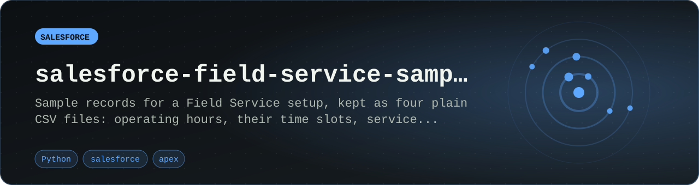
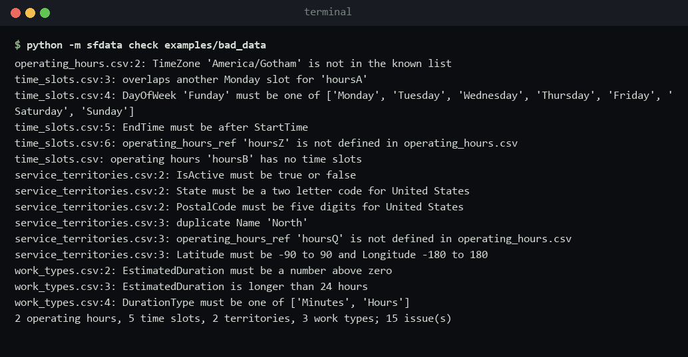

<p align="center"></p>

# salesforce-field-service-sample-data

[](https://github.com/yassine2med/salesforce-field-service-sample-data/actions/workflows/ci.yml)  

Sample records for a Field Service setup, kept as four plain CSV files: operating hours, their time slots, service territories and work types. A Python tool checks the files and the links between them, then converts them into the JSON tree files and `plan.json` that `sf data import tree` reads. No org is needed to check or build.



## What it is for

Admins setting up a Field Service sandbox usually start from a blank org and click records in by hand. Use these files as a starting point: edit the CSVs in a spreadsheet, run the checker to catch overlapping time slots, unknown references or impossible coordinates, then load the generated tree into a sandbox yourself with the Salesforce CLI. This repo does not log in to Salesforce, and the import step is yours to run and verify in your own sandbox.

## Install

```
git clone https://github.com/yassine2med/salesforce-field-service-sample-data
cd salesforce-field-service-sample-data && pip install -r requirements.txt
```

## What is in data

| File | Records | Notes |
|---|---|---|
| `operating_hours.csv` | 3 | Name and time zone. `ref` is a local key used by the other files |
| `time_slots.csv` | 12 | Day of week with start and end time, linked by `operating_hours_ref` |
| `service_territories.csv` | 4 | City level location, coordinates, active flag, linked to operating hours |
| `work_types.csv` | 5 | Estimated duration in minutes or hours |

The `tree/` folder holds the generated output, so you can use it without running Python.

## How to use

| I want to | Command |
|---|---|
| Check the shipped data | `PYTHONPATH=src python -m sfdata check` |
| Check a folder of your own CSVs | `PYTHONPATH=src python -m sfdata check path/to/folder` |
| Rebuild the tree files | `PYTHONPATH=src python -m sfdata build data --out tree` |
| See a folder with mistakes | `PYTHONPATH=src python -m sfdata check examples/bad_data` |
| Show help | `PYTHONPATH=src python -m sfdata --help` |

Exit codes: 0 when clean, 1 when issues exist (and `build` writes nothing), 2 when the folder is missing.

Loading the generated files into a sandbox you own is done with the Salesforce CLI, for example `sf data import tree --plan tree/plan.json --target-org <your sandbox alias>`. Run that yourself and check the result in the org.

Example:

```
PYTHONPATH=src python -m sfdata check examples/bad_data
```

Output:

```
operating_hours.csv:2: TimeZone 'America/Gotham' is not in the known list
time_slots.csv:3: overlaps another Monday slot for 'hoursA'
time_slots.csv:4: DayOfWeek 'Funday' must be one of ['Monday', 'Tuesday', 'Wednesday', 'Thursday', 'Friday', 'Saturday', 'Sunday']
time_slots.csv:5: EndTime must be after StartTime
time_slots.csv:6: operating_hours_ref 'hoursZ' is not defined in operating_hours.csv
time_slots.csv: operating hours 'hoursB' has no time slots
service_territories.csv:2: IsActive must be true or false
service_territories.csv:2: State must be a two letter code for United States
service_territories.csv:2: PostalCode must be five digits for United States
service_territories.csv:3: duplicate Name 'North'
service_territories.csv:3: operating_hours_ref 'hoursQ' is not defined in operating_hours.csv
service_territories.csv:3: Latitude must be -90 to 90 and Longitude -180 to 180
work_types.csv:2: EstimatedDuration must be a number above zero
work_types.csv:3: EstimatedDuration is longer than 24 hours
work_types.csv:4: DurationType must be one of ['Minutes', 'Hours']
2 operating hours, 5 time slots, 2 territories, 3 work types; 15 issue(s)
```

Building the shipped data:

```
3 operating hours, 12 time slots, 4 territories, 5 work types; 0 issue(s)
wrote tree\OperatingHours.json
wrote tree\TimeSlot.json
wrote tree\ServiceTerritory.json
wrote tree\WorkType.json
wrote tree\plan.json
```

Run the tests with `python -m pytest -q`.

## What the checker verifies

1. All four files exist and have the required columns.
2. `ref` values are unique and use letters, digits and underscores.
3. Operating hours: name present and unique, time zone in a known list (a subset of what Salesforce accepts, defined in `core.py`).
4. Time slots: a valid weekday, `HH:MM` times, end after start, no overlap on the same day for the same hours, a known operating hours ref, and every operating hours record has at least one slot.
5. Territories: unique names of at most 80 characters, a known operating hours ref, `IsActive` of true or false, latitude and longitude in range, and for United States a two letter state and a five digit postal code.
6. Work types: unique names, duration above zero and at most 24 hours, `DurationType` of Minutes or Hours.

## How the conversion works

Operating hours are written first with `saveRefs`, so the later files can point at them with `@ref` values. The plan lists the files in load order: operating hours, time slots, service territories, work types.

## Limits

- Only these four objects are covered. Service resources, skills and work orders need users and org specific Ids.
- The tree format and field names follow Salesforce documentation, but they have not been loaded into an org by this repo.
- Locations are city level sample values, not real service areas.

## License

MIT. Yassine Emhamed, 2026.
